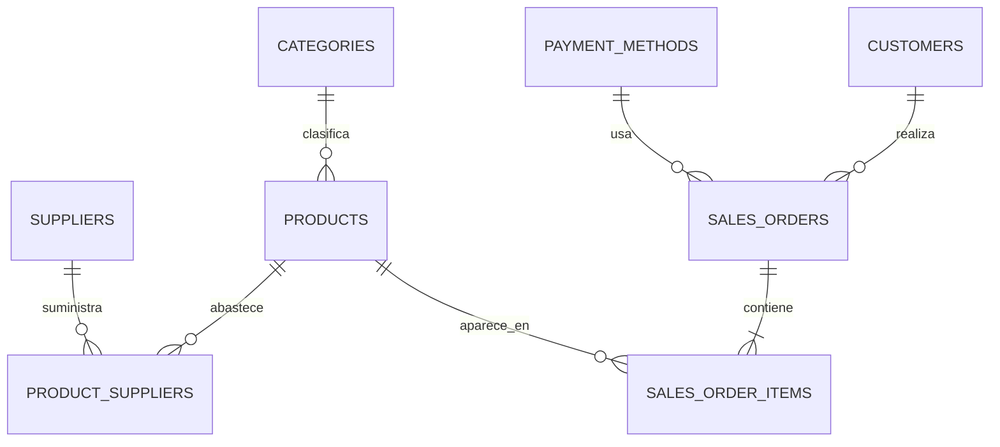

# La Despensa

Catálogo y pedidos de una tienda de barrio, preparado como proyecto de portafolio. El ejemplo convierte los ejercicios de modelado y consultas de DAW en una aplicación pequeña que se puede ejecutar desde una instalación limpia.

La tienda y sus datos son ficticios. Se puede elegir pagar al recoger el pedido o probar la opción de tarjeta; esta última solo simula la elección, no pide datos ni procesa un cobro.

## Qué incluye

- Un modelo relacional con categorías, proveedores, productos, clientes, pedidos y métodos de pago.
- Restricciones, claves foráneas, índices y relaciones de muchos a muchos.
- Consultas preparadas para el catálogo y los informes.
- Vistas para totales de pedidos, avisos de existencias y ventas diarias.
- Desencadenadores que impiden vender más unidades de las disponibles y descuentan el stock.
- Una API HTTP para consultar el catálogo y registrar pedidos con una transacción.
- Una interfaz adaptable para buscar productos, preparar la cesta y confirmar un pedido ficticio.
- Pruebas automatizadas de consultas, validación, pedidos, stock y respuestas HTTP.

## Requisitos

Node.js 24.15 o posterior. La aplicación usa `node:sqlite`, incluido en Node; no necesita instalar paquetes con npm. En Node.js, `node:sqlite` está en etapa de candidata a estable, así que este proyecto está pensado para aprendizaje y demostración local, no como una tienda de producción. La [documentación oficial de Node.js](https://nodejs.org/api/sqlite.html) describe su estado y uso.

## Puesta en marcha

Desde esta carpeta:

```powershell
node server.js
```

Abre `http://127.0.0.1:3000`. La base de datos local se crea en `data/mercado.sqlite` al arrancar. Para empezar de nuevo, cierra el servidor y borra ese archivo.

Para ejecutar las pruebas:

```powershell
node --test
```

Consulta los [casos de prueba y el registro de resultados](CASOS-DE-PRUEBA.md) para ver qué comprueba cada prueba y su alcance.

## API

| Método | Ruta | Uso |
|---|---|---|
| `GET` | `/api/health` | Comprueba el servicio y la base de datos |
| `GET` | `/api/categories` | Devuelve las categorías |
| `GET` | `/api/payment-methods` | Devuelve los métodos ficticios disponibles |
| `GET` | `/api/products` | Filtra por categoría, texto, precio y página |
| `GET` | `/api/products/:id` | Consulta un producto |
| `GET` | `/api/reports/summary` | Devuelve cifras de catálogo y ventas |
| `GET` | `/api/orders/:number` | Consulta un pedido sin exponer el correo del cliente |
| `POST` | `/api/orders` | Registra un pedido de demostración |

Ejemplo de cuerpo para `POST /api/orders`:

`paymentMethod` puede ser `pickup` (pago en tienda al recoger) o `card-demo` (opción de tarjeta simulada, sin cobro).

```json
{
  "customer": {
    "name": "Alicia Moreno",
    "email": "alicia@example.test"
  },
  "paymentMethod": "pickup",
  "items": [
    { "productId": 1, "quantity": 2 },
    { "productId": 4, "quantity": 1 }
  ]
}
```

## Modelo de datos



El detalle del modelo y el motivo de sus restricciones están en `docs/modelo-relacional.md`. Las consultas de análisis están en `database/queries.sql`.

## Prácticas Java de DAW

También se incluyen cuatro ejercicios de Java, con una guía de ejecución para cada uno: [ver los proyectos Java](../practicas-java/README.md). Cubren lógica de programación, orientación a objetos, interfaces gráficas y acceso a bases de datos.

## Decisiones y límites

Los precios se guardan en céntimos enteros para evitar errores de redondeo. El registro del pedido se realiza dentro de una transacción; si una línea no se puede guardar, se revierten también los cambios de stock. El formulario comprueba el nombre y el correo. No solicita números de tarjeta ni realiza cargos: la opción de pago en línea solo sirve para demostrar cómo quedaría el flujo.

Es una demo local de una sola instancia. No incluye cuentas de usuario, recuperación de contraseña, pasarela de pagos, envío real, despliegue público ni operaciones de devolución. Antes de presentar el proyecto, revisa cada decisión y asegúrate de poder explicar el modelo, las consultas, la transacción y los desencadenadores.

## Estructura

```text
database/   esquema, datos iniciales y consultas
docs/       modelo y decisiones del proyecto
public/     interfaz del catálogo
test/       pruebas automatizadas
```

Las prácticas Java están en `../practicas-java/`.
